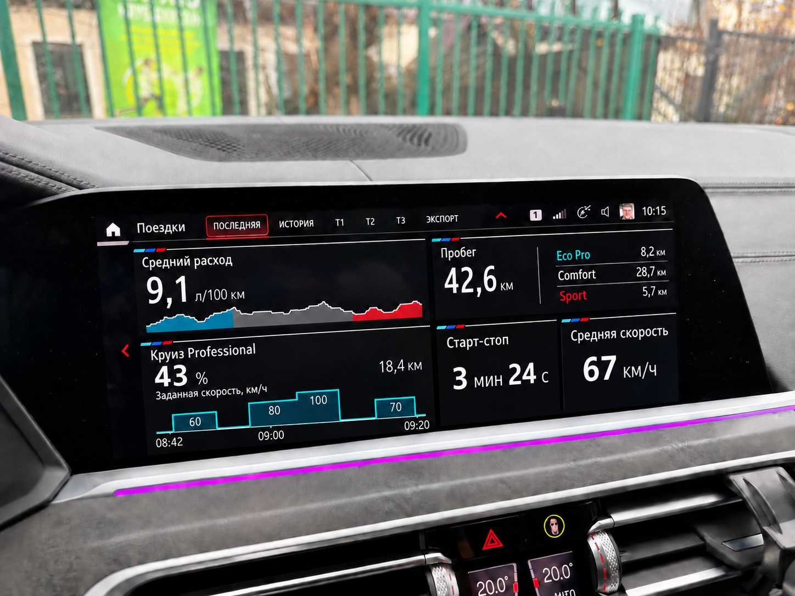
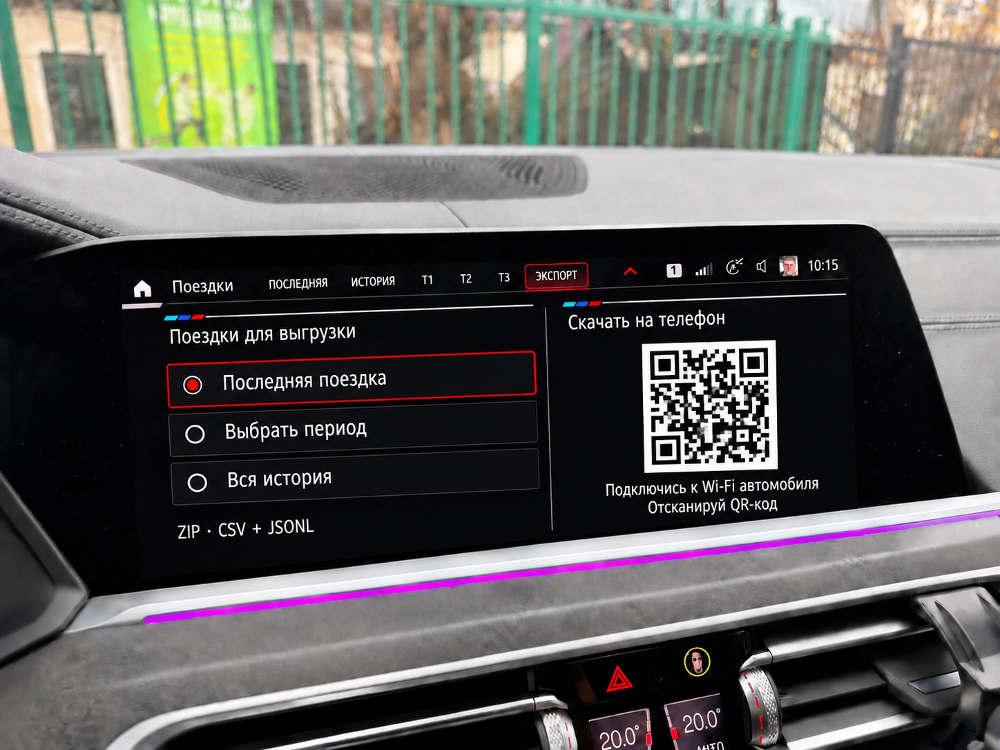

# Поездки для BMW iDrive 7

Первая тестовая версия для BMW MGU с установленным MGU Store. Приложение запускается вместе с iDrive и ведёт локальный журнал поездок. Графики и значения на макетах ниже демонстрационные.

## Установка через MGU Store

1. Подключи MGU Store к интернету.
2. На дисплее BMW открой **MGU Store → Settings → Add source**.
3. Введи **ZozobakaGit/mgu-trip-log** и выбери ветку **main**.
4. Найди **«Поездки»** и нажми **Install**. Store соберёт пакет на MGU.
5. Перезапусти головное устройство через **Settings → Restart head unit**. Приложение появится в списке iDrive. Фоновая запись запускается вместе с платформой.

Репозиторий публичный. Установку и чтение сигналов на реальной машине ещё нужно проверить.

## Журнал

- **Последняя** показывает текущую или последнюю завершённую поездку.
- **История** открывает предыдущие поездки.
- **T1, T2, T3** — независимые счётчики. Подтверждённый сброс меняет начало отсчёта.
- Пробег вычисляется по сигналу скорости. Режимы движения сохраняются с таймстемпами. Старт-стоп оценивается по статусу двигателя, разрешению MSA, положению коробки и скорости.
- Расход берётся из диагностического чтения двигателя, если соответствующий параметр доступен. Для расчёта среднего требуется покрытие минимум 90% измеренного времени. На графике Eco Pro синий, Comfort серый, Sport красный.
- Запись начинается при движении от 2 км/ч. Завершение определяется выключенным двигателем в P, остановкой приложения или длительным пропуском данных. Замеры записываются раз в секунду, буфер сбрасывается на диск раз в 10 секунд.

## Экспорт на телефон

1. В iDrive открой **Экспорт** и выбери последнюю поездку, период (1, 7, 30 или 90 дней) или всю историю.
2. Нажми **Подготовить ZIP**. Приложение покажет QR с локальной ссылкой, действующей 5 минут.
3. Подключи телефон к хотспоту BMW и отсканируй QR. Сохрани ZIP в «Файлы». На Mac его можно передать через AirDrop.

В архиве `trips.csv`, `samples.csv`, `events.csv` и исходный `raw/*.jsonl`. Таблицы связаны по `trip_id`, отметки времени в UTC. При выборе объёма свыше 16 МиБ исходных записей приложение попросит сократить период. Доступ через соединение CarPlay зависит от сетевой конфигурации автомобиля.

## Диагностика Professional

Вкладка **Диагностика → Сформировать отчёт** читает каталог интерфейсов SOME/IP на MGU и выгружает `cruise-diagnostics.json` тем же способом. В отчёт попадают кандидаты по названиям, определения интерфейсов и известные значения из BimmerLink. [Список наблюдений и план сверки](docs/BMW_X7_ACC_diagnostics.md).

Источники фактической активности Professional и заданной скорости на MGU ещё предстоит подтвердить. Эти поля в журнале пока пустые. Интерфейс и расчёт ступеней готовы для подключения сигнала. На обзорном графике короткие изменения уставки до 3 секунд объединяются по последнему значению.

## Использованные проекты

- [iDrive 7 Apps / Drive Log](https://github.com/arefahmad/idrive7-apps) — основа комплекта сборки. Лицензии в `kit/`.
- [iDrive 7 Apps / M Vitals и Redline](https://github.com/cauliflowermossgrape/idrive7-apps) — ориентир по оформлению и чтение расхода. Лицензия в `kit/LICENSE.vitals`.
- [qrcode-generator](https://github.com/kazuhikoarase/qrcode-generator) — генерация QR без интернета. Лицензия в папке приложения.
